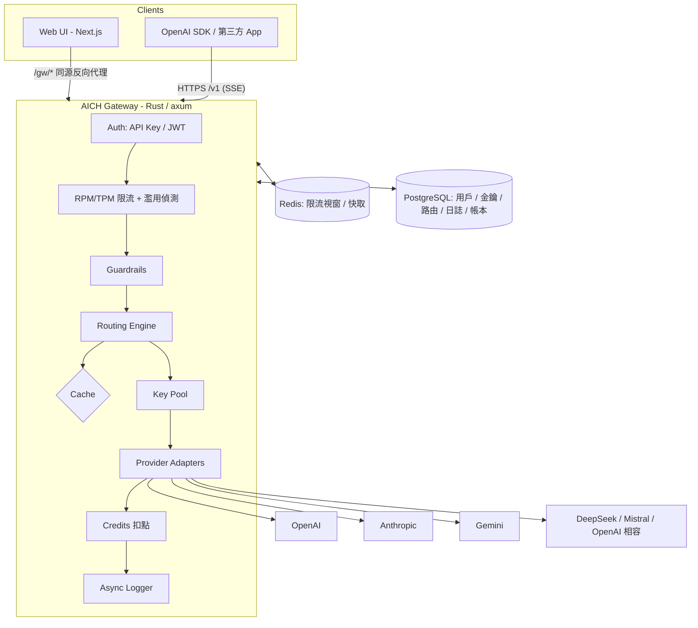
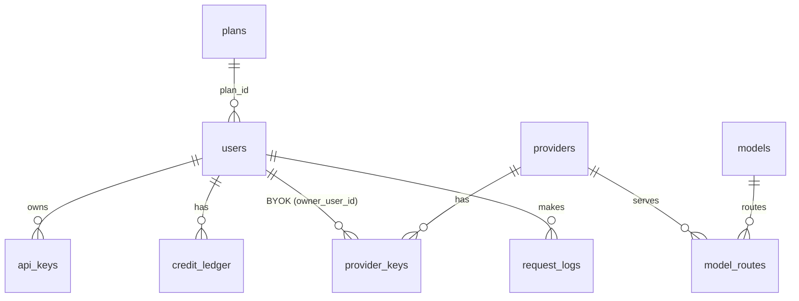

# 系統架構

## 1. 元件

| 元件 | 技術 | 職責 |
| --- | --- | --- |
| Gateway | Rust、axum 0.8、tokio、reqwest（rustls）、sqlx | 對外 OpenAI 相容 API、路由、備援、計費、用戶與管理 API |
| Web | Next.js 16（App Router）、React 19、Tailwind 4 | 聊天 WebUI、開發者控制台、管理後台；`/gw/*` 同源代理 Gateway |
| PostgreSQL 16 | | 主資料：方案、用戶、API 金鑰、供應商與加密金鑰、模型/路由、請求日誌、點數帳本、設定 |
| Redis 7（選用） | | 多實例共享的限流視窗、濫用計數、回應快取；未設定時退回行程內記憶體 |

## 2. 請求生命週期（`POST /v1/chat/completions`）

1. **鑑權**：`Authorization: Bearer sk-hub-…`（或 `x-api-key`）以 SHA-256 雜湊查 `api_keys`；網頁登入則驗證 JWT。
2. **授權**：方案的模型等級（basic/premium）、API 存取權、金鑰的允許模型、金鑰額度上限、用戶點數餘額。
3. **限流**：以「金鑰（或用戶）× 分鐘」為視窗，RPM 計次、TPM 以預估 prompt tokens 計量；超限回 429 並累計濫用次數。
4. **Guardrails**：敏感詞 / Prompt Injection（off/flag/block）。
5. **路由規劃**：取得模型的所有路由 → 過濾（供應商停用、預算斷路、無可用金鑰、斷路器開啟）→ 依策略排序。
6. **快取**（非串流）：temperature=0 或 `X-Hub-Cache: true` 時以請求內容雜湊查快取（用戶範圍隔離）。
7. **嘗試迴圈**：依序取候選 → 斷路器 `try_acquire` → 金鑰池選鑰 → Adapter 轉換協定並呼叫上游。
   - 可重試錯誤（5xx、404、408、429、401/403、逾時、連線失敗）→ 記錄健康度 / 金鑰冷卻 → 下一候選。
   - 不可重試（400/413/422）→ 直接回傳給客戶端。
   - 串流：等到上游第一個 chunk 才回應客戶端，因此首字前的失敗都能透明備援。
8. **計費**：使用上游回報的 usage（缺少時以估算值），依路由價格扣點；寫入 `api_keys.credits_used`。
9. **日誌**：送入非同步佇列，每 1 秒或 200 筆批次寫入 `request_logs`，不阻塞請求。

串流回應由獨立 task 抽取上游資料並推送給客戶端，即使客戶端中途斷線，計費與日誌仍會完成（狀態碼記為 499）。

## 3. 原始碼導覽（gateway/src）

| 模組 | 說明 |
| --- | --- |
| `types.rs` | OpenAI Chat Completions 線路型別（未知欄位保留並轉送） |
| `providers/` | `openai.rs`（含所有 OpenAI 相容服務）、`anthropic.rs`、`gemini.rs`、`mock.rs`、`sse.rs` |
| `routing/` | `mod.rs` 規劃與排序、`intent.rs` 意圖分類、`health.rs` EWMA + 斷路器、`keypool.rs` 金鑰輪替 |
| `catalog.rs` | 供應商/金鑰/模型/方案/設定的記憶體快照，30 秒或後台變更時重新載入（ArcSwap 原子替換） |
| `billing.rs` | 點數計算、扣點、加值帳本、每月方案點數發放 |
| `handlers/` | `chat.rs`（/v1）、`portal.rs`（/auth、/api）、`admin.rs`（/admin） |
| `kv.rs` | Redis / 記憶體 KV 抽象 |
| `logging.rs` | 非同步批次日誌 |
| `crypto.rs` | AES-256-GCM、API 金鑰產生與雜湊、Argon2 密碼、JWT |

## 4. 資料模型

主要欄位見 `gateway/migrations/0001_init.sql`；種子資料（方案、供應商、模型、路由）見 `0002_seed.sql`。

## 5. 擴展與部署

- **水平擴展**：Gateway 無狀態（健康度與金鑰冷卻為各實例本地狀態，屬於刻意設計：各實例獨立探測上游）。設定 `REDIS_URL` 後，限流與快取在實例間共享。
- **資料庫**：`request_logs` 為最大的表，建議依月分區並設定保留期（見 roadmap）。
- **效能**：Gateway 只做串流轉送與 JSON 轉換，不做阻塞 I/O；日誌與計費以外的資料庫查詢只有鑑權一次。
- **觀測**：`AICH_LOG_FORMAT=json` 輸出結構化日誌；`/health` 供健康檢查；管理後台提供即時健康度與統計。
