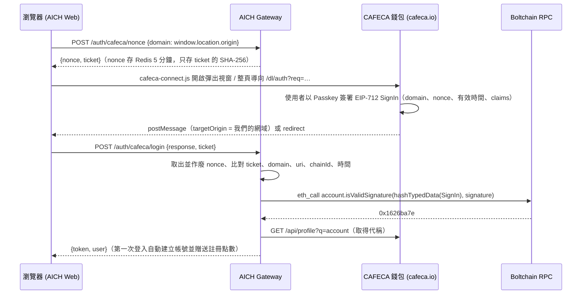

# 登入與身分：Sign in with CAFECA

AICH 以 **[CAFECA](https://cafeca.io)** 作為主要登入方式（[協定說明](https://github.com/Luphia/cafeca#sign-in-with-cafeca第三方網站登入串接)）。使用者以裝置上的 Passkey 簽署登入訊息，不需要帳號密碼；Email／密碼登入仍保留（例如啟動時建立的管理員）。

## 流程

- **使用者 ID** = CAFECA 身分合約地址（`users.cafeca_account`，小寫）。換裝置、換 Passkey、恢復身分都不變；代稱可變更，只用於顯示。
- **nonce 綁定瀏覽器**：Gateway 不用 cookie，因此每個 nonce 會配一個只有該瀏覽器知道的 `ticket`（存在 sessionStorage）。nonce 在驗證前就被原子性取出作廢，不可重送。
- **網域**：`message.domain` 必須與 `AICH_CAFECA_SITE_ORIGINS` 中、申請 nonce 時的 origin 完全相同（含 scheme 與 port）。仿冒網站拿到的簽章綁定的是它自己的網域，在 AICH 驗證會失敗。
- **驗證完全在 AICH 端完成**：EIP-712 雜湊以 Rust 實作（單元測試與 viem `hashTypedData` 的輸出逐位元比對），簽章用公開 RPC 呼叫 ERC-1271 驗證，不需要 CAFECA 的 API key。
- **行動裝置**：自動改用整頁導向（`/login/cafeca` 接收結果）；桌機彈出視窗被擋時也會自動退回導向。

## 帳號綁定

- Email 帳號可在「帳號與方案 → CAFECA 數位身分」綁定 CAFECA（`POST /api/me/cafeca/nonce` → `POST /api/me/cafeca`），之後兩種方式都能登入。
- 一個 CAFECA 身分只能綁一個 AICH 帳號。
- 只以 CAFECA 建立的帳號不能解除綁定（否則無法登入）；有 Email 與密碼的帳號可以解除（`DELETE /api/me/cafeca`）。

## 設定

| 變數 | 預設 | 說明 |
| --- | --- | --- |
| `AICH_CAFECA_SITE_ORIGINS` | `http://localhost:3000` | 使用者登入時瀏覽器網址列的 origin，可用逗號分隔多個。**正式環境務必設為 `https://<你的網域>`** |
| `AICH_CAFECA_WALLET` | `https://cafeca.io` | 錢包網址；Gateway 從 `/.well-known/cafeca-configuration` 讀取 chainId 與 RPC。設為空字串即停用 |
| `AICH_CAFECA_RPC` | 錢包公布的 RPC | 建議正式環境改用自架節點 |

網站資訊 `web/public/.well-known/cafeca-site.json`（名稱、圖示）會顯示在錢包的確認畫面，已設定 `Access-Control-Allow-Origin: *`。

## 尚未納入（可依需求開啟）

- `kyc_level`（實名等級）、`legal_name` 等 KYC claims：可用於企業方案或提高額度前的實名要求。
- 跨裝置 QR 登入（`post` 模式）。
- 簽章通道（登入後請使用者簽署條款或以 TWDC 付款）— 可作為點數儲值的金流選項。

## 測試

- `cargo test cafeca`：EIP-712 雜湊與 `isValidSignature` calldata 與 viem 輸出一致、網域/nonce/過期檢查。
- `CAFECA_MOCK=1 ./scripts/e2e.sh`（搭配 `scripts/fake_upstreams.py` 的假錢包與假 RPC）：錯誤簽章、nonce 重放、偷用 ticket、建立帳號、重複登入、綁定與解除綁定。
- 假錢包也提供 `/dl/auth` 頁面與 SDK（`CAFECA_SDK_PATH=<下載的 cafeca-connect.js>`），可用瀏覽器實際走完彈出視窗與行動版導向流程。
